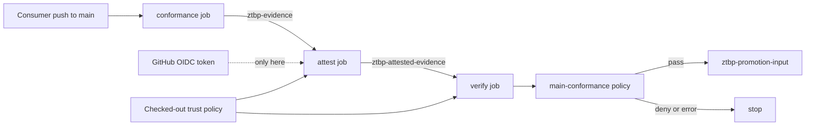

# Zero Trust GitHub Workflows

`bodharma/zero-trust-workflows` provides a supported V1 reusable GitHub Actions
check workflow for Python repositories using uv. It also publishes a fixed
trusted-evidence chain in `v1.1.1`: conformance, main-only keyless
attestation, and independent verification. These workflows deliberately expose
no inputs or secrets. A caller can select the reviewed workflow commit, but
cannot replace a command, runner, tool version, artifact path, or policy gate.

## Prerequisites and local checks

The caller must supply a committed `pyproject.toml`, `uv.lock`, and a working
`Makefile` whose `check` target performs its required checks. There is no input
for changing the command, Python version, runner, or dependency installation.
To check this repository locally with uv installed:

```sh
uv sync --locked --dev && make check
```

Here, `make check` validates the workflow policy, runs pytest, and runs Ruff.

## Direct reuse

Copy [examples/direct-caller.yml](examples/direct-caller.yml) into your
repository's `.github/workflows/ci.yml`. It calls the public workflow by a full
40-character commit SHA, with `pull_request` and pushes to `main` as triggers
and only `contents: read` permissions. The reusable workflow executes against
the caller's code; the caller needs no fork or copy of this library.

Every external workflow or action reference must use a full 40-hex SHA, never
a mutable branch or tag. Review the workflow and its pinned actions before
adopting a SHA. The supported V1 example pins the tested workflow commit
`80c78d69c9a8aaf969420cfe690bdeae16b95879`, verified by successful
[canonical CI](https://github.com/bodharma/zero-trust-workflows/actions/runs/38070964419)
and [consumer main CI](https://github.com/bodharma/zer_trust_infra/actions/runs/38071226452)
at consumer commit `e6dee7d7c8a8727a8bbd10f86bc44ef80cab2271`.
The [published `v1.0.1` release](https://github.com/bodharma/zero-trust-workflows/releases/tag/v1.0.1)
contains this Python 3.13 selection correction; immutable `v1.0.0` is superseded
by the correction. Consumers must keep the full SHA pin when adopting `v1.0.1`.
To update, review the replacement workflow and action pins, change
the caller's SHA in a pull request, and require passing caller CI before
merging. To roll back, restore the previous reviewed SHA in the caller and
rerun its CI.
Local `./` workflow references resolve at the same commit as the caller workflow.

## Trusted evidence chain

The chain separates observation, signing authority, and authorization. Evidence
is data about a run; it is not trusted merely because a test produced it or an
artifact transported it. Trust is established only after an exact identity and
context verification, followed by the checked-out promotion policy.



| Workflow | What its only job means | Permission | Fixed result |
| --- | --- | --- | --- |
| `reusable-conformance.yml` | `conformance` builds the repository's pinned AMD64 workload and runs its Kubernetes evidence producer | `contents: read` | `ztbp-evidence` |
| `reusable-evidence-attestation.yml` | `attest` revalidates the evidence, creates its deterministic index, and keylessly signs that index | `contents: read`, plus job-scoped `id-token: write` | `ztbp-attested-evidence` |
| `reusable-evidence-verification.yml` | `verify` verifies the Sigstore bundle and exact producer context, then evaluates `main-conformance` | `contents: read` | `ztbp-promotion-input` after policy success |

The `conformance` job has a 30-minute timeout because it builds a container and
starts kind. Attestation and verification each have a 10-minute timeout. A
timeout is a denial, never an implicit success.

### What the fixed pieces protect

| Fixed piece | Meaning |
| --- | --- |
| Full action commit SHA | GitHub executes the reviewed action revision rather than a mutable tag |
| uv 0.13.0 and Python 3.13 | Dependency resolution and the consumer runtime stay on the tested contract |
| kind 0.33.0 checksum | The directly downloaded Kubernetes harness must match the reviewed Linux AMD64 bytes |
| kubectl 1.35.9 checksum and Cosign 3.1.3 | Cluster-client bytes and signature behavior cannot silently change |
| `main` push guard | OIDC signing cannot run for pull-request code, another branch, or a manual event |

Each workflow prints and asserts its tool versions before dependency installation
or consumer commands. Setup actions are pinned, and the kind binary receives a
second, byte-level SHA-256 check. The kubectl setup receives the reviewed official
checksum, and checkout does not persist its token in the consumer repository. The
artifact actions are also pinned. Hidden file upload is enabled only because the
exact allow-listed paths live below `.artifacts/`; it does not widen the upload to
the repository.

### Artifacts are transport, not trust

`ztbp-evidence` contains only `.artifacts/trusted/evidence`. It is an unsigned
producer output and must not authorize promotion. `ztbp-attested-evidence`
contains that evidence plus `evidence-index.json` and its modern Sigstore bundle,
`evidence-index.sigstore.json`. Verification downloads the set, checks every
digest and identity claim, and creates a new normalized
`promotion-input.json`. Only that normalized input reaches Rego.

`ztbp-promotion-input` retains only the normalized policy input for seven days so
a successful decision can be diagnosed without publishing the raw repository.
Denied and errored runs publish no promotion-input artifact. It is uploaded only
after signature verification and `make promotion-check` succeed. All uploads fail
when their exact expected files are absent, and every artifact expires after seven
days.

### Adopt the chain

1. Provide the fixed `make trusted-evidence` and `make promotion-check` contracts,
   a locked uv project, the gate `main-conformance`, and `trust/github-main.yaml`.
2. Copy [examples/trusted-evidence-caller.yml](examples/trusted-evidence-caller.yml)
   to `.github/workflows/trusted-evidence.yml` in the consumer repository.
3. Keep all three reusable workflow references pinned to the reviewed `v1.1.1`
   commit `0f9c834d44b63ba6587ad5c35434bd874629a687`; do not replace it with the tag.
4. Review and bind the consumer trust policy to that workflow SHA, certificate
   identity, repository ID/name, workflow name, event, and `refs/heads/main`.
5. Require the verification job in branch or environment protection before any
   separate deployment workflow consumes the decision.

The [published `v1.1.1` release](https://github.com/bodharma/zero-trust-workflows/releases/tag/v1.1.1)
points to that immutable commit and corrects only the uv version-output assertion;
the workflow and policy contracts are unchanged. The caller repeats the exact
main-push guard and delegates `id-token: write` only to the attestation call. GitHub
does not let a called workflow elevate above its caller, so both sides are required.
Conformance and verification never receive OIDC permission. Updating the pin is a
trust-policy change: review the new workflow bytes first, then update all three
caller references and the policy's workflow SHA and certificate identity together.

### v1.1.1 acceptance record

[Consumer main run 38134599975](https://github.com/bodharma/zer_trust_infra/actions/runs/38134599975)
completed successfully at consumer commit
`d1101278d3d975f3b9d45113fdb2a14a94380737`, using workflow release commit
`0f9c834d44b63ba6587ad5c35434bd874629a687` and Cosign v3.1.3. The observed
certificate SAN exactly matched:

```text
https://github.com/bodharma/zero-trust-workflows/.github/workflows/reusable-evidence-attestation.yml@0f9c834d44b63ba6587ad5c35434bd874629a687
```

Five copied-input negative cases failed closed:

| Mutation | Exit | Promotion input created |
| --- | ---: | --- |
| Index byte changed | 1 | No |
| Evidence byte changed | 1 | No |
| Evidence file missing | 1 | No |
| Certificate identity wrong | 1 | No |
| Expected commit SHA wrong | 1 | No |

The matching Rekor entry is log index `3206178263`, UUID
`108e9186e8c5677a7dee3b8525cf59f8b26f504cf90b324030fbcfbc3566a2a046d75c365985ef1d`,
with API-body SHA-256
`91ab20c4d1b185abe1e29769fd2d0ae5218530a90f853a19e6f2556b40010cb9`.
The API body matched the bundle and exposed only the DSSE-envelope digest,
payload digest, signature, and verifier certificate; it exposed neither the
predicate nor evidence content. This repository records only these audit
identifiers and results, not the bundle or evidence artifacts.

### Fail-closed behavior

The chain stops when a download is missing, a checksum or asserted version
differs, the producer command fails, the signing context is not the protected
main push, Cosign cannot prove the exact issuer and identity, evidence or index
bytes differ, a required assertion is absent, or Rego denies the normalized
input. Later jobs use `needs`, so an earlier failure or skipped attestation does
not fall through to verification.

The artifact service is not a trust anchor. The attestation covers the index,
the index binds the evidence bytes and producer context, and verification uses
policy from the independently checked-out consumer commit. Deployment remains a
separate responsibility; these workflows produce and verify a promotion
decision but do not deploy anything.

## Trust boundary and non-goals

Do not pass secrets, use `secrets: inherit`, or add secret expressions. The
workflows have no input or secret contract, deployment credentials, or
customer-specific configuration. GitHub still supplies its built-in
`GITHUB_TOKEN`, restricted here to reading repository contents. The trusted
evidence chain adds OIDC only to the job and event described above. Every
workflow runs caller-controlled code after version checks; use it only on code
you are prepared to execute in that repository's CI boundary.

Deployment, infrastructure provisioning, cloud authentication, secret
management, and customizable build orchestration remain outside the contract.
The local policy validator checks workflow structure and references; it is not a
secret scanner, a sandbox, or proof that dependencies and shell commands are
safe. A compromised GitHub-hosted runner, pinned third-party action, consumer
dependency, or consumer `Makefile` remains inside the execution risk boundary.
New capabilities require a separately reviewed workflow contract.

## Public copies and private isolation

Public GitHub forks remain public; a fork of this public repository cannot be
made private independently. Public forks share Git data within their network.
A local clone is a working copy, and its remotes determine where later pushes
go; cloning does not create an independent private GitHub repository. See
[GitHub's fork visibility documentation](https://docs.github.com/en/pull-requests/reference/forks).

For organization-specific changes, use the
[independent private-copy runbook](examples/isolated-copy.md). Create an empty
private repository outside the public fork network, import reviewed code, and
keep public-upstream access fetch-only. Direct reuse, public collaboration,
and independent private copies are separate distribution choices.

## Reporting and license

Follow [SECURITY.md](SECURITY.md) for private vulnerability reports. Changes are
recorded in [CHANGELOG.md](CHANGELOG.md). Copyright 2026 bodharma. This project
is licensed under [Apache-2.0](LICENSE).
